<p align="center">
  <a href="https://qrlytix.com/"></a>
</p>

<h1 align="center">QR Code Templates</h1>

<p align="center">
  12 free, print-ready QR code templates in 5 colours — editable SVG for Figma, Canva, Illustrator and Inkscape.<br>
  Payments, menus, Wi‑Fi, reviews, business cards, events and more.
</p>

<p align="center">
  <a href="https://qrlytix.com/qr-code-generator"><b>Generate your QR code</b></a> ·
  <a href="#templates">Browse templates</a> ·
  <a href="docs/qr-content-formats.md">QR formats</a> ·
  <a href="docs/qr-print-guide.md">Print guide</a> ·
  <a href="#license">License</a>
</p>

<p align="center">
  
  
  
  
</p>

<p align="center">
  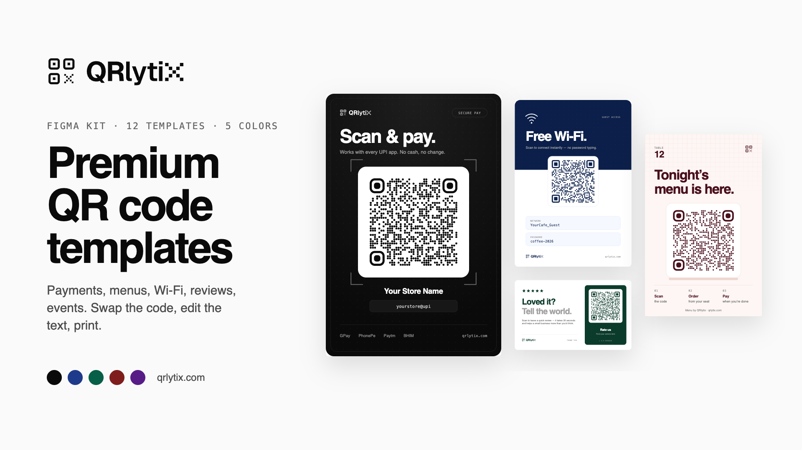
</p>

## Why these templates

- **Ready to print.** Real layouts for real use — a counter standee, a table tent, a Wi‑Fi card — not just a frame around a code.
- **Fully editable.** Clean, named SVG layers. Change text, colours and the QR in any vector editor.
- **Built to scan.** Every QR sits on white with a proper quiet zone, in every colour variant.
- **5 colourways.** Mono, Navy, Emerald, Burgundy and Plum for each template — 60 files total.

## Quick start

1. Pick a template from [`templates/`](templates) (or download the [ZIP](../../archive/refs/heads/main.zip)).
2. Create your QR code at **[qrlytix.com](https://qrlytix.com/qr-code-generator)** and download it as SVG.
3. Open the template, delete the sample QR group, paste yours in the same spot.
4. Edit the text, export as PDF, print.

**Figma:** drag the `.svg` onto the canvas — it imports as editable layers.
**Canva:** Uploads → upload the `.svg` → add to your design.

## Templates

| | Template | Best for | Size (px) |
|---|---|---|---|
| 01 | [UPI Payment Standee](templates/mono/01-payment-standee.svg) | Counter-top scan-to-pay | 600×900 |
| 02 | [Menu Table Tent](templates/mono/02-menu-table-tent.svg) | Contactless restaurant menu | 500×780 |
| 03 | [Review Card](templates/mono/03-review-card.svg) | Collecting Google reviews | 900×540 |
| 04 | [Wi‑Fi Card](templates/mono/04-wifi-card.svg) | Guests join without typing a password | 600×860 |
| 05 | [Business Card](templates/mono/05-business-card-duo.svg) | Front + back with vCard QR | 1130×1340 |
| 06 | [Instagram Story](templates/mono/06-instagram-story.svg) | Print-to-profile follows | 1080×1920 |
| 07 | [Event Badge](templates/mono/07-event-badge.svg) | Scan-to-connect at events | 640×980 |
| 08 | [Product Authenticity Label](templates/mono/08-product-label.svg) | Verifying genuine products | 900×520 |
| 09 | [App Download Card](templates/mono/09-app-download.svg) | One scan to the app stores | 900×500 |
| 10 | [Property Sign Rider](templates/mono/10-property-sign.svg) | Listing details from the curb | 1200×500 |
| 11 | [Wedding RSVP Card](templates/mono/11-wedding-rsvp.svg) | RSVPs in seconds | 600×860 |
| 12 | [QR Frames Set](templates/mono/12-qr-frames-set.svg) | Six frames for any QR | 940×800 |

<details>
<summary><b>See all previews</b></summary>

<br>

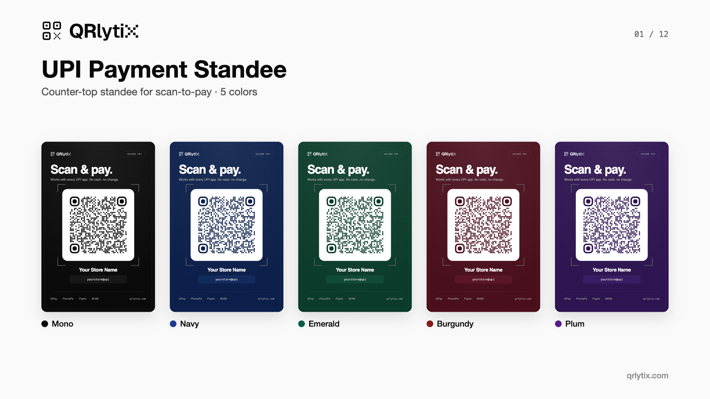
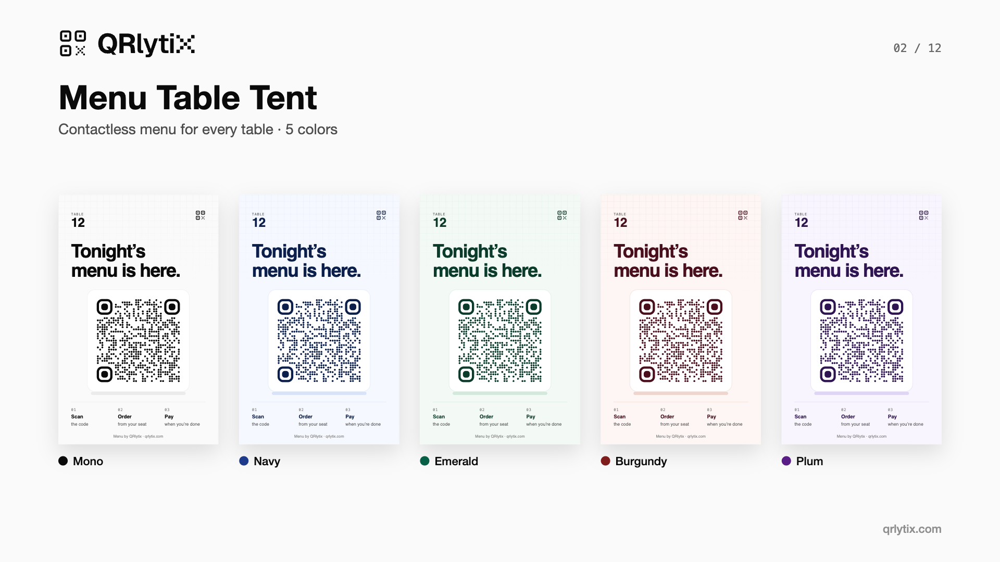
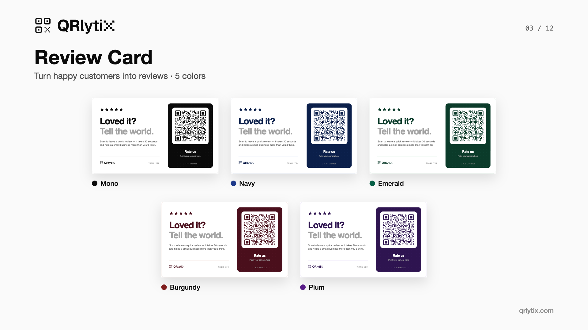
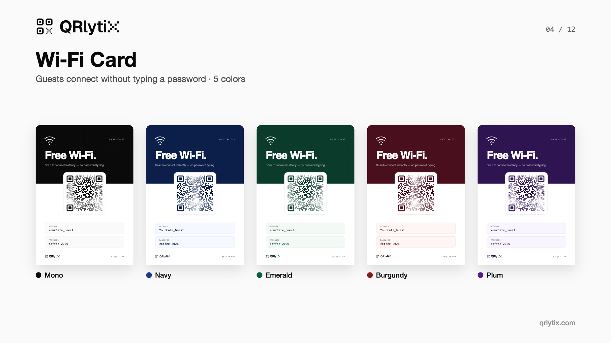
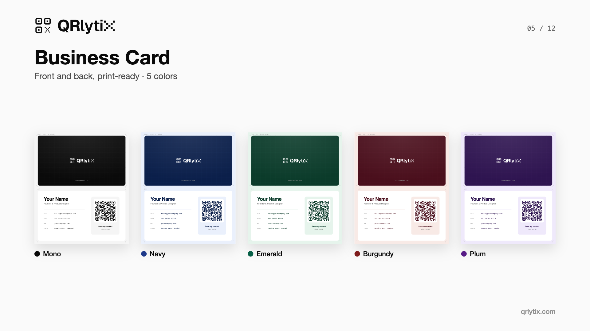
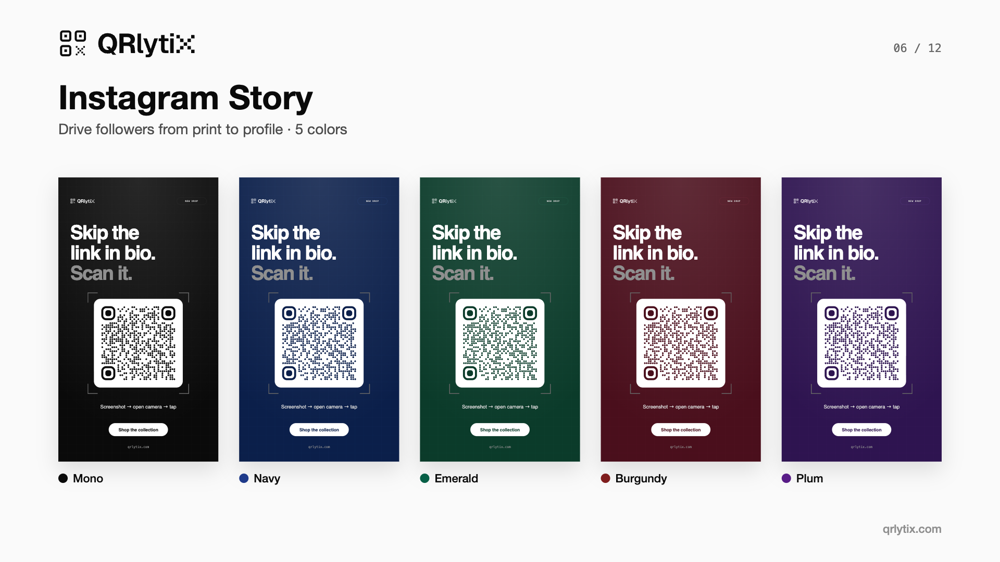
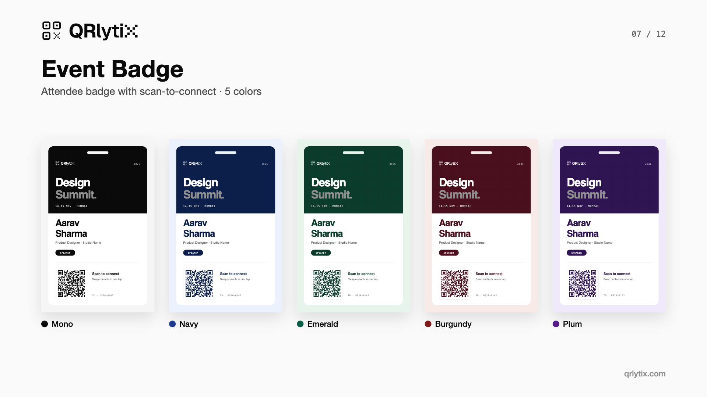
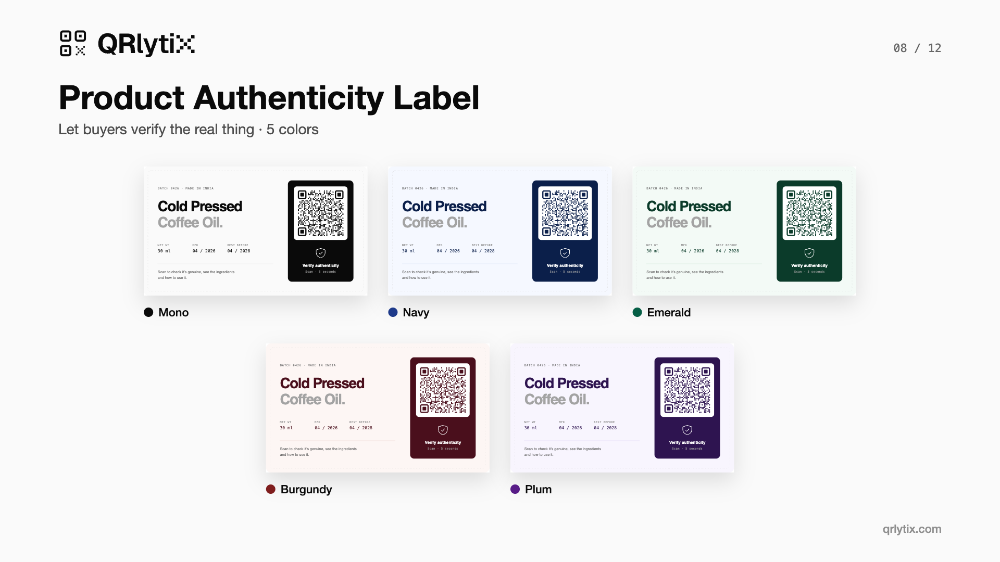
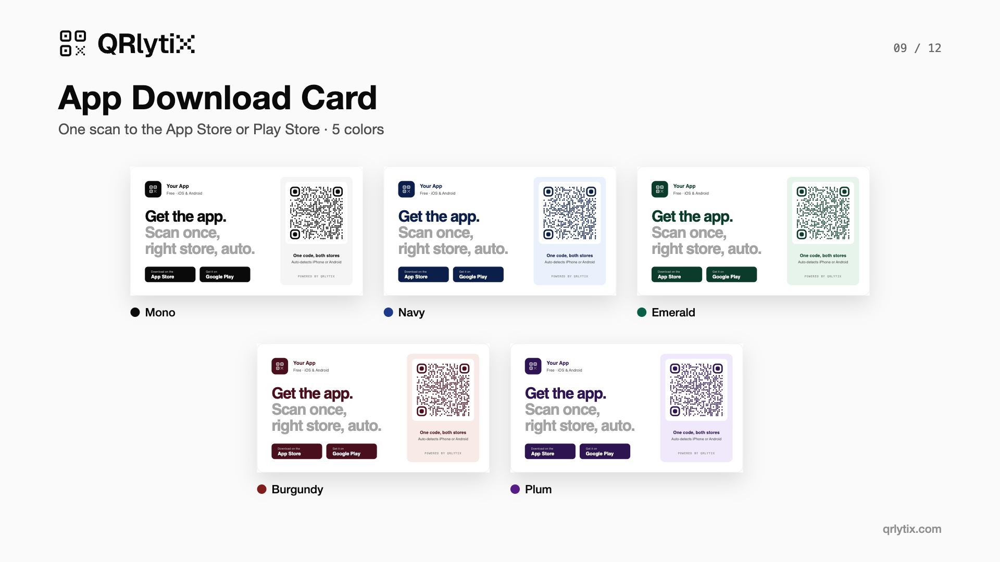
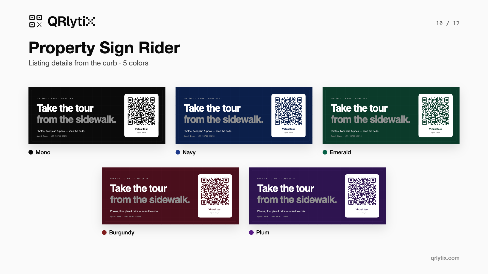
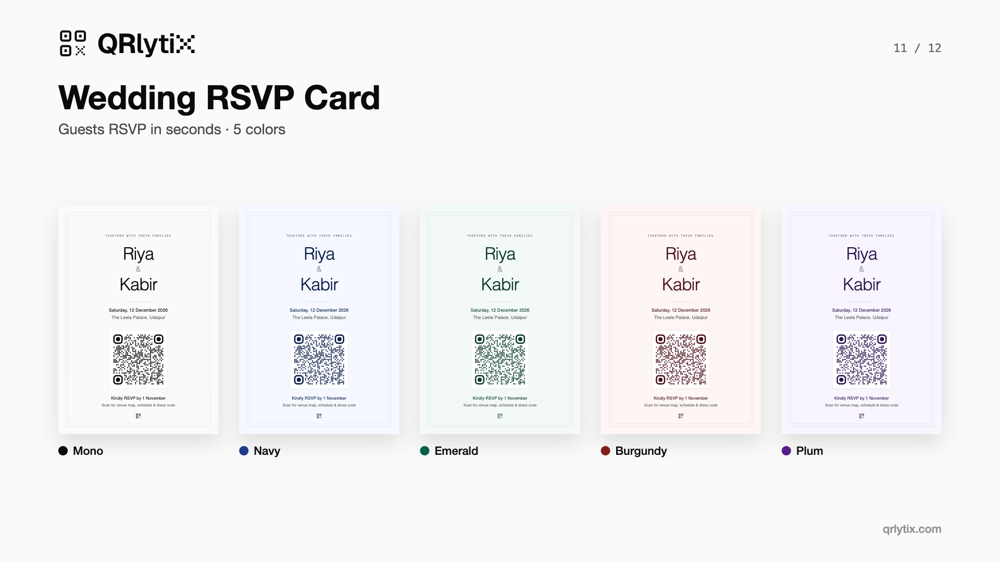
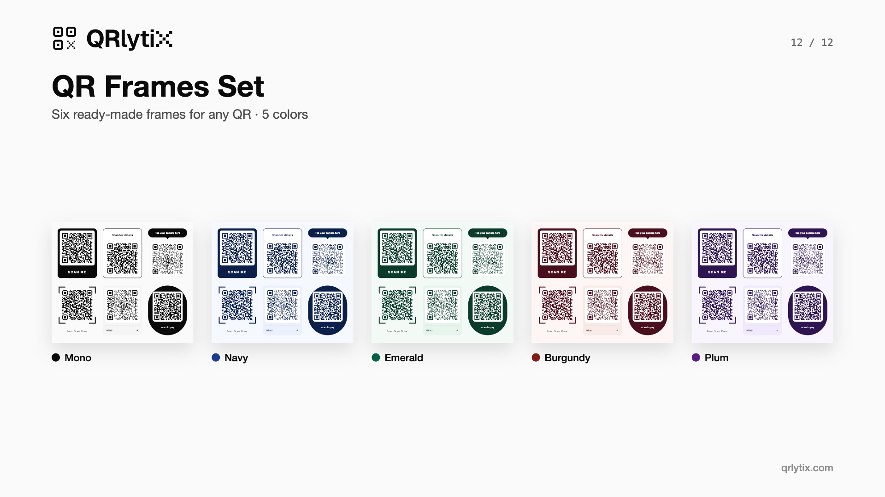

</details>

## Colours

| Folder | Colour | Hex |
|---|---|---|
| [`templates/mono`](templates/mono) | Mono | `#0A0A0A` |
| [`templates/navy`](templates/navy) | Navy | `#1E3A8A` |
| [`templates/emerald`](templates/emerald) | Emerald | `#065F46` |
| [`templates/burgundy`](templates/burgundy) | Burgundy | `#7F1D1D` |
| [`templates/plum`](templates/plum) | Plum | `#581C87` |

Need a different brand colour? Select the coloured layers and change one fill — the QR stays on white.

## For developers

[`templates.json`](templates.json) lists every template, size and colour, so you can build file paths programmatically:

```js
const { templates, colors } = await fetch('templates.json').then(r => r.json());
const path = (t, c) => c.id === 'mono'
  ? `templates/mono/${t.id}.svg`
  : `templates/${c.id}/${t.id}${c.suffix}.svg`;
```

A zero-dependency gallery with a colour switcher lives in [`index.html`](index.html) — enable **GitHub Pages** (Settings → Pages → `main` / root) to host it.

## What to put inside each QR

Every template needs a different kind of QR. Copy-paste formats for UPI, Wi‑Fi, vCard, Google reviews, WhatsApp, app stores and more are in **[QR content formats](docs/qr-content-formats.md)**.

| Template | QR type |
|---|---|
| Payment Standee | UPI link |
| Wi‑Fi Card | Wi‑Fi (auto-connect) |
| Business Card | vCard |
| Review Card | Google review link |
| App Download | Smart app link |
| Menu, Property, RSVP, Badge, Label | URL (dynamic recommended) |

## Print tips

- Print the QR at **at least 2 × 2 cm**; for every 10 cm of scan distance add 1 cm.
- Keep dark-on-light. Don't invert the QR.
- Always test-scan the printed proof with two different phones.

More in the [QR print guide](docs/qr-print-guide.md).

## License

Templates are released under **[CC BY 4.0](LICENSE)** — free for personal and commercial use, including client work.
Please keep a credit somewhere visible (README, site footer or product page):

```
QR templates by QRlytix — https://qrlytix.com
```

## Also by QRlytix

- **[QRlytix](https://qrlytix.com/)** — dynamic QR codes with scan analytics.
- **Figma Community** — the same kit as a Figma file: *12 QR Code Templates for Figma — Payments, Menus, Cards & More*.

If this saved you time, a ⭐ helps others find it.
